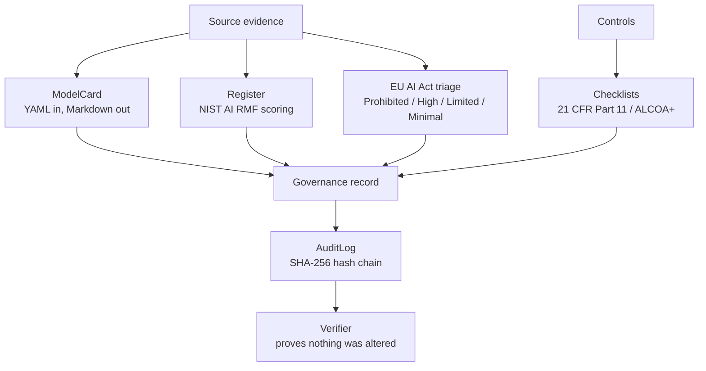

# ai-governance-kit

**Production-grade AI governance artefacts with zero runtime dependencies.**

Model cards, NIST AI RMF risk registers, EU AI Act risk triage, GxP compliance
checklists, and tamper-evident audit logs — as a Python library and a `govkit`
command-line tool.

Built on the standard library alone. No PyYAML, no cloud SDKs, no network calls.

---

## Why this exists

"Govern AI" usually means one of two things: a 60-page PDF nobody reads, or a
spreadsheet that drifts out of date the week after it is made. Neither gives an
engineer anything they can use in a pull request or a pipeline.

This toolkit takes the opposite approach: **governance as code**. A risk register
is a JSON file with a schema. A model card is YAML that renders to a document a
review board can sign. The audit trail is a hash chain that proves nobody edited
history. All of it runs in CI, and all of it is reviewable in a diff.

The trade-off is deliberate. This is a *records and triage* toolkit, not a
compliance engine. It cannot tell you whether you are compliant, and it does not
try. What it does is make the evidence easy to produce, hard to alter, and easy
to audit — which is most of the actual work.

## Quick start

No installation needed:

```bash
git clone https://github.com/sajjad-rabby/ai-governance-kit.git
cd ai-governance-kit
python examples/demo_end_to_end.py
```

Or install it to get the `govkit` command:

```bash
pip install -e .
govkit --help
```

Requires Python 3.9 or newer. Runtime dependencies: none.

---

## The five capabilities



### 1. Model cards

```python
from ai_governance_kit import ModelCard

card = ModelCard.load("examples/model_card.yaml")
print(card.render())              # Markdown for a review board
print(card.to_yaml())             # normalized YAML, for round-tripping
```

The YAML subset parser (`yaml_min`) is deliberately small: mappings, block and
flow sequences, scalars, block scalars, and comments. It handles the model-card
schema completely, and it rejects tab indentation rather than guessing.

### 2. NIST AI RMF risk register

Risks are scored `severity x likelihood` on 1–5 axes and banded:

| Score | Band |
| --- | --- |
| 0–4 | Low |
| 5–11 | Medium |
| 12–19 | High |
| 20–25 | Critical |

Every risk is mapped to one of the four AI RMF functions — Govern, Map, Measure,
Manage — so the register doubles as a coverage check on your process.

```python
from ai_governance_kit import Register

register = Register.load_json("examples/risk_register.json")
register.save_csv("register.csv")                  # for spreadsheets
print(register.render_markdown("Q3 Model Risk Review"))
```

JSON and CSV round-trip losslessly, including multi-item mitigation lists.

### 3. EU AI Act triage

A rule engine that answers six yes/no questions plus one use-case choice, then
returns a tier with cited reasoning.

```python
from ai_governance_kit import classify_answers

classify_answers({"use_case": "employment", "rights_or_access": True})
# {'tier': 'High', 'reasons': ["Use case '...' is listed in Annex III as high-risk."], ...}
```

The engine is **conservative in a specific way**: prohibited practices are
checked first and win outright, and a high-risk use case stays High even when the
questionnaire says rights are not affected. Downgrading a tier is a legal
judgement, so the rules never make that call for you.

> This is decision support derived from public summaries of Regulation (EU)
> 2024/1689. It is **not legal advice** and carries no legal force.

### 4. Compliance checklists

21 CFR Part 11 (16 items) and ALCOA+ (9 items), each with guidance and a
regulatory reference, rendered with checkboxes and a sign-off table.

```python
from ai_governance_kit import PART11_CHECKLIST, render_markdown

print(render_markdown(PART11_CHECKLIST, {"P11-05": True, "P11-06": True}))
```

### 5. Tamper-evident audit log

Each entry hashes its own content together with the previous entry's hash:

```
hash_n = SHA256(canonical_json({prev_hash: hash_n-1, ...entry}))
```

Editing any historical entry breaks every hash after it.

```python
from ai_governance_kit import AuditLog

log = AuditLog("governance.jsonl")
log.append("release.approved", {"approver": "model-risk-board"})
log.verify()   # [] means intact; otherwise a list of {"line", "reason"}
```

The CLI refuses to append to a log that fails verification, so a compromised
chain cannot be quietly extended:

```bash
$ govkit audit append --path governance.jsonl --event release.approved
error: refusing to append: existing log failed verification (1 problem(s));
       first: hash mismatch (entry modified or corrupted)
```

---

## CLI

```bash
govkit card       --input card.yaml [--to-yaml] [--output card.md]
govkit register   --path register.json [--format json|csv|markdown] [--title T]
govkit register-summary --path register.json [--json]
govkit classify   --use-case employment [--social-scoring yes] [--json]
govkit questions                      # print the classification questionnaire
govkit checklist --standard part11|alcoa [--checked A-01,A-02]
govkit audit append --path audit.jsonl --event E [--payload '{"k":1}']
govkit audit verify --path audit.jsonl
```

Examples:

```console
$ govkit classify --use-case emotion_recognition
Tier: Limited
Use case: emotion_recognition

Reasons:
  - Emotion recognition in workplace/education is restricted; disclosure applies (Art. 50(3)).

This classification is rule-based decision support... NOT legal advice.

$ govkit register-summary --path examples/risk_register.json
ID      SCORE  BAND     RMF      TITLE
R-002      15  High     Measure  No drift monitoring in production
R-001      16  High     Map      Training data provenance undocumented
...
```

---

## Design notes

**Stdlib only, on purpose.** A governance tool that fails to install is a
governance tool nobody uses. `yaml_min` is ~600 lines and covers the subset this
toolkit needs; swapping in PyYAML later is a one-line change.

**Deterministic hashing.** Audit hashes use sorted keys and fixed separators, so
the same logical entry always produces the same digest regardless of Python dict
ordering or platform.

**Fail loudly on tampering.** An audit log is only worth anything if corrupting it
is inconvenient. Every code path that reads the log verifies the chain, and the
CLI refuses writes to an unverified log.

**Conservative classification.** The EU AI Act engine never downgrades a tier on
its own reasoning. It flags Annex III use cases, cites the article, and leaves
the legal call to a human.

## Project layout

```
ai_governance_kit/
  yaml_min.py       minimal YAML parser/dumper
  model_card.py     ModelCard dataclass, YAML <-> Markdown
  risk_register.py  Risk, Register, severity scoring, JSON/CSV/Markdown
  eu_ai_act.py      rule-based tier classifier
  checklists.py     21 CFR Part 11 and ALCOA+ definitions
  audit_log.py      hash-chained JSONL log + verifier
  cli.py            govkit entry point
examples/
  model_card.yaml
  risk_register.json
  demo_end_to_end.py
tests/              180 offline tests
```

## Testing

```bash
python -m pytest tests
```

The suite is fully offline and covers the YAML parser, both serialisation
round-trips, the scoring boundaries, every classification branch, tamper
detection, and the whole CLI surface.

## License

MIT © 2026 Sajjad Rabby